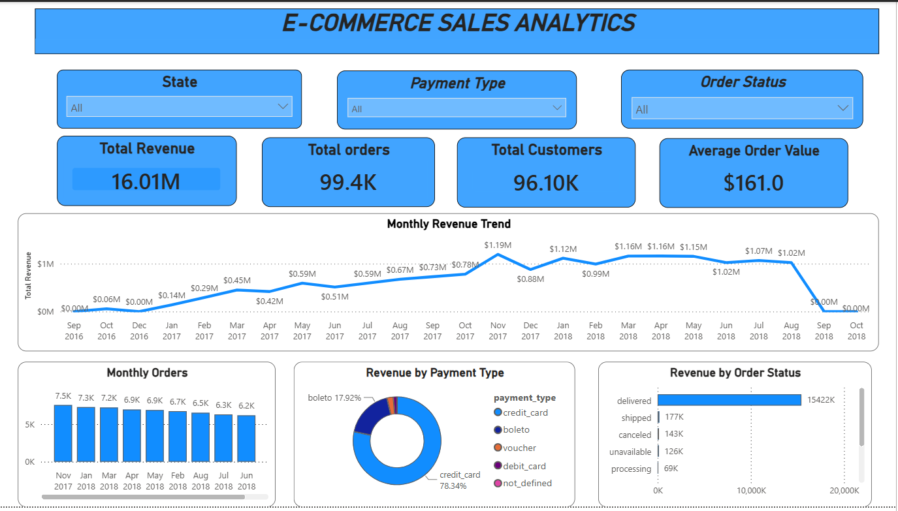
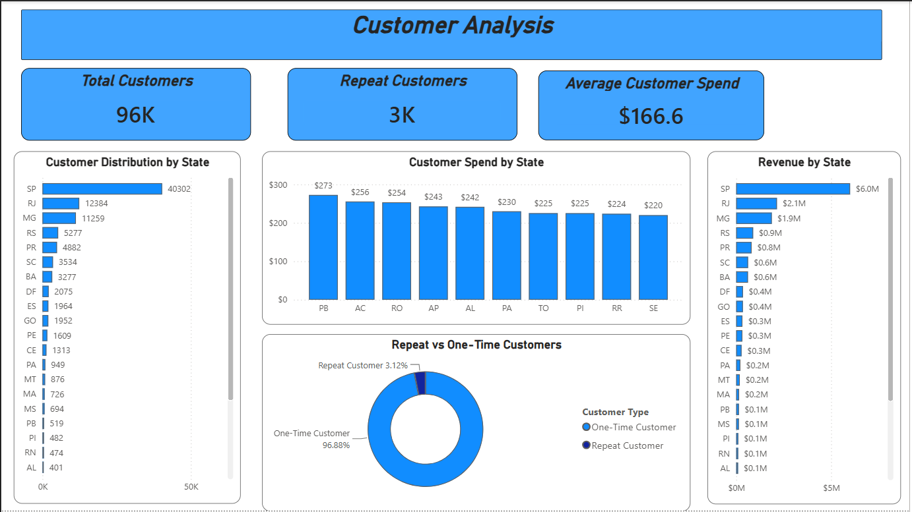
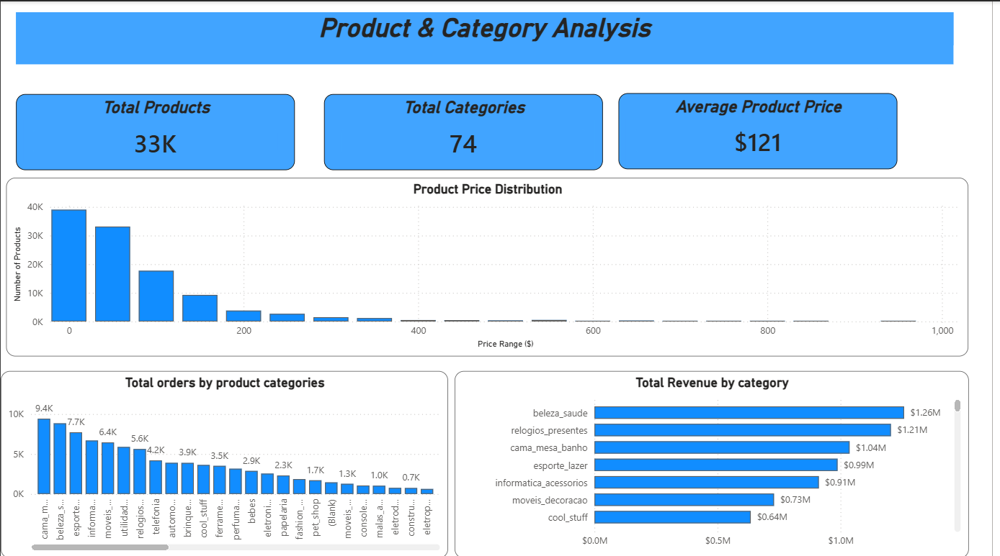
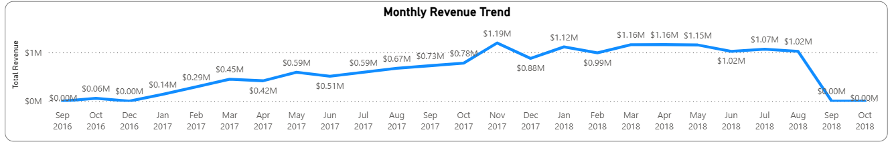
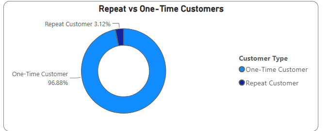
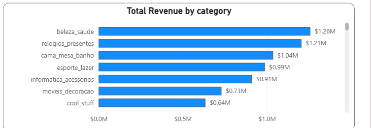

# Olist E-Commerce Analytics

### SQL Server | Advanced SQL | Power BI | Business Analytics

An end-to-end e-commerce analytics project built to answer a practical business question:

> **What is driving e-commerce revenue, how are customers behaving, which products are performing best, and where are the strongest business opportunities?**

This project transforms raw Olist transaction data into **validated data, business-focused SQL analysis, advanced analytical insights, and an interactive Power BI dashboard.**

---

## 📌 Business Problem

The business has a large amount of transactional data across customers, orders, products, and payments, but raw data alone does not provide a clear picture of business performance.

Management needs to understand:

- How revenue changes over time
- Which product categories generate the most revenue
- Whether customers return after their first purchase
- Which states contribute the most customers and revenue
- Which payment methods customers prefer
- How order status affects revenue
- Which customer and product segments deserve attention

### Core Question

> **How can historical e-commerce transaction data be used to understand sales performance, customer behavior, product performance, payment preferences, and geographic concentration to identify opportunities for revenue growth and stronger customer retention?**

---

## 🎯 Project Objectives

- Analyze overall sales and revenue performance
- Identify monthly revenue trends
- Measure average order value
- Analyze one-time versus repeat customers
- Evaluate customer spending and geographic distribution
- Identify high-performing product categories
- Analyze payment methods and payment contribution
- Evaluate revenue by order status
- Apply advanced SQL techniques for deeper analysis
- Build an interactive Power BI dashboard
- Translate analysis into actionable business recommendations

---

## 📊 Dashboard Preview

### Sales Analysis


### Customer Analysis


### Product & Category Analysis


---

## 🔎 Key Business Insights

### 1. Customer Retention Is the Biggest Opportunity

The project identified **96,096 unique customers**.

- **93,099** customers are one-time purchasers
- **2,997** customers are repeat purchasers
- Approximately **96.88%** of customers purchased only once

This indicates a major opportunity to improve customer retention and repeat purchasing.

### 2. Revenue Is Geographically Concentrated

| State | Customer Records |
|---|---:|
| São Paulo (SP) | 41,746 |
| Rio de Janeiro (RJ) | 12,852 |
| Minas Gerais (MG) | 11,635 |
| Rio Grande do Sul (RS) | 5,466 |
| Paraná (PR) | 5,045 |

São Paulo alone represents approximately **41.98%** of customer records.

### 3. Credit Card Is the Dominant Payment Method

Credit cards account for:

- **76,795 payment records**
- Approximately **$12.54M** in payment value
- Approximately **78.34%** of total payment value

### 4. A Small Group of Categories Drives Major Revenue

| Rank | Category | Revenue |
|---:|---|---:|
| 1 | beleza_saude | $1.26M |
| 2 | relogios_presentes | $1.21M |
| 3 | cama_mesa_banho | $1.04M |
| 4 | esporte_lazer | $988K |
| 5 | informatica_acessorios | $912K |

### 5. November 2017 Was the Strongest Revenue Month

The highest monthly revenue identified was approximately **$1.19M in November 2017**.

### 6. Delivered Orders Dominate Analyzed Revenue

Approximately **96.34%** of analyzed order-item revenue is associated with delivered orders.

---

## 📈 Selected Analysis Visuals

### Monthly Revenue Trend


### Repeat vs One-Time Customers


### Revenue by Product Category


---

## 🧠 Advanced SQL Analysis

This project goes beyond basic aggregation.

### Techniques Used

- CTEs
- `CASE`
- Subqueries
- `RANK()`
- `DENSE_RANK()`
- `ROW_NUMBER()`
- `LAG()`
- `SUM() OVER()`
- `NTILE(4)`
- Running totals
- Month-over-month analysis
- Customer segmentation
- Revenue ranking
- Pareto-style revenue concentration
- Top-N analysis by state

### Business Questions Answered

- Who are the highest-value customers?
- How does revenue change month over month?
- Which product categories rank highest by revenue?
- Who are the top five customers in each state?
- How can customers be segmented by revenue?
- How concentrated is revenue across categories?

---

## 🛠️ Data Quality & Validation

A dedicated SQL data-quality module checks:

- Table and row counts
- Missing values
- Duplicates
- Primary-key consistency
- Foreign-key relationships
- Order-level consistency
- Product-level missing values

### Important Findings

**Orders**
- 160 missing `order_approved_at`
- 1,783 missing `order_delivered_carrier_date`
- 2,965 missing `order_delivered_customer_date`

**Products**
- 610 missing `product_category_name`
- 610 missing product name length
- 610 missing description length
- 610 missing photo quantity
- 2 missing product weight
- 2 missing length
- 2 missing height
- 2 missing width

The selected product dataset contains **73 distinct non-null product categories**.

---

## 🗂️ Dataset Structure

```text
Customers
    │
    │ customer_id
    ▼
Orders
    │
    ├──────────────► Order Payments
    │
    │ order_id
    ▼
Order Items
    │
    │ product_id
    ▼
Products
```

| Dataset | Rows | Main Purpose |
|---|---:|---|
| `olist_customers_dataset.csv` | 99,441 | Customer & geographic analysis |
| `olist_orders_dataset.csv` | 99,441 | Sales & order performance |
| `olist_order_items_dataset.csv` | 112,650 | Revenue & product sales |
| `olist_order_payments_dataset.csv` | 103,886 | Payment behavior |
| `olist_products_dataset.csv` | 32,951 | Product & category analysis |

---

## 🧩 Project Structure

```text
Olist-Ecommerce-Analytics/
│
├── README.md
├── .gitignore
│
├── dataset/
│   ├── olist_customers_dataset.csv
│   ├── olist_orders_dataset.csv
│   ├── olist_order_items_dataset.csv
│   ├── olist_order_payments_dataset.csv
│   └── olist_products_dataset.csv
│
├── SQL/
│   ├── data_quality_check/
│   ├── eda/
│   ├── sales_analysis/
│   ├── Customer_analysis/
│   ├── product analysis/
│   └── Advance_analysis/
│
├── dashboard/
│   └── dashboard.pbix
│
├── documentation/
│   ├── Business_Problem.md
│   ├── Data_Dictionary.md
│   └── Olist_Final_Project_Report.docx
│
└── images/
    ├── sales_analysis_dashboard.png
    ├── customer_analysis_dashboard.png
    ├── product_category_analysis_dashboard.png
    ├── monthly_revenue_trend.png
    ├── revenue_by_payment_type.png
    ├── repeat_vs_one_time_customers.png
    └── revenue_by_category.png
```

---

## 📊 Power BI Dashboard

### Sales Analysis
Focuses on revenue, orders, average order value, monthly revenue, order status, and payment performance.

### Customer Analysis
Focuses on unique customers, one-time vs repeat customers, customer spending, state distribution, and geographic concentration.

### Product & Category Analysis
Focuses on product count, category revenue, product performance, pricing, and category comparisons.

---

## 💼 Business Recommendations

### Improve Customer Retention
The very high one-time customer share suggests that retention should be a major priority.

Potential actions:
- Post-purchase engagement
- Personalized recommendations
- Repeat-purchase offers
- Customer loyalty initiatives

### Focus on High-Performing Categories
Use category-level revenue analysis for inventory planning, promotions, and merchandising.

### Analyze Regional Opportunities
Use state-level customer and revenue performance to protect strong markets and investigate lower-contributing regions.

### Monitor Order Outcomes
Track canceled, unavailable, and other unsuccessful orders separately to identify operational issues.

### Maintain Strong Payment Experience
Because credit cards dominate payment value, payment reliability and convenience should remain a priority.

---

## 🧰 Tech Stack

| Tool | Purpose |
|---|---|
| **Microsoft SQL Server** | Data analysis & querying |
| **SSMS** | SQL development |
| **SQL** | EDA, validation & business analysis |
| **Power BI** | Dashboard & visualization |
| **CSV** | Source datasets |
| **GitHub** | Version control & documentation |

---

## 📚 Documentation

Detailed documentation is available in `documentation/`:

- **Business Problem** — business context, challenges, objectives, and scope
- **Data Dictionary** — datasets, columns, relationships, metrics, and data-quality findings
- **Final Project Report** — detailed analysis, dashboard screenshots, insights, and recommendations

---

## 🚀 How to Explore

### 1. Understand the Business Problem
Open:

```text
documentation/Business_Problem.md
```

### 2. Understand the Data
Open:

```text
documentation/Data_Dictionary.md
```

### 3. Explore the SQL Analysis

Start with:

```text
SQL/data_quality_check/
```

Then explore:

```text
SQL/eda/
SQL/sales_analysis/
SQL/Customer_analysis/
SQL/product analysis/
SQL/Advance_analysis/
```

### 4. Open the Dashboard

Open:

```text
dashboard/dashboard.pbix
```

Explore the three Power BI pages to interact with the analysis.

---

## 📌 Dataset Source

**Olist Brazilian E-Commerce Public Dataset**

An anonymized Brazilian e-commerce dataset covering transactions from 2016–2018.

Source: https://www.kaggle.com/olistbr/brazilian-ecommerce/

> Check the dataset's licensing and redistribution terms before publishing the raw CSV files publicly.

---

## 🔮 Future Improvements

- Customer Lifetime Value analysis
- Customer churn analysis
- Profitability and margin analysis
- Demand forecasting
- Predictive customer segmentation
- Product demand forecasting
- Marketing campaign attribution
- Seller performance analysis
- Delivery-time performance analysis
- Automated reporting

---

## 👤 Project Focus

**SQL → Data Validation → Exploratory Analysis → Advanced Analytics → Business Insights → Power BI → Data Storytelling**

The emphasis is not only on writing SQL queries, but on using data to answer **real business questions and support better business decisions.**
